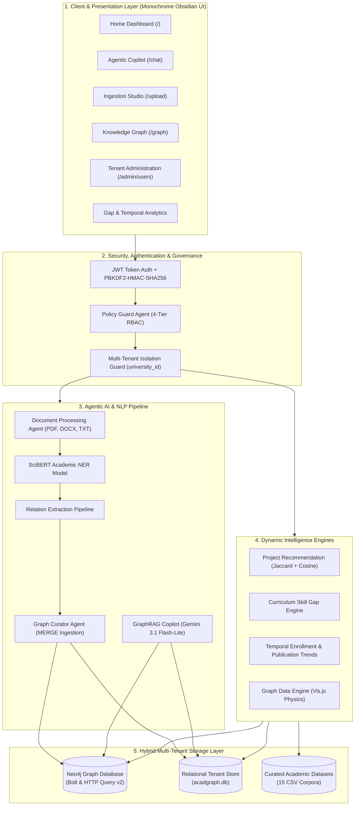

# AcadGraph: Agentic AI-Driven Multi-Tenant Academic Knowledge Graph Platform

[](https://www.python.org/)
[](https://fastapi.tiangolo.com/)
[](https://neo4j.com/)
[](https://ai.google.dev/)
[](https://huggingface.co/)
[]()
[]()

**AcadGraph** is an enterprise-grade, Multi-Tenant Academic Knowledge Graph SaaS platform engineered as a Final Year Capstone Project. Powered by an **Agentic Multi-Agent Swarm** and **Google Gemini GraphRAG**, it transforms unstructured academic documents (syllabi, research papers, project proposals) into deeply interconnected, multi-tenant knowledge graphs in **Neo4j** while enforcing strict 4-tier Role-Based Access Control (RBAC) and tenant data isolation across universities.

---

## 🏛️ System Architecture



---

## 🌟 Key Engineering Innovations

### 1. Dual-Tier Multi-Tenancy Architecture
- **Tenant Isolation**: Node and relationship partitioning using `university_id` across all local university entities (`Student`, `Faculty`, `Course`, `Project`, `Department`).
- **Global Shared Ontology**: Universal nodes for `Skill`, `Topic`, and `Technology` enable cross-institutional research analytics, industry gap benchmarking, and inter-university project collaboration without exposing private student records.
- **Cross-Tenant Attack Prevention**: Backend RBAC enforcement prevents administrative escalation or data leaks across university boundaries.

### 2. Real Agentic GraphRAG with Google Gemini
- **Multi-Hop Graph Grounding**: Instead of relying on naive vector search over raw text chunks, the Copilot executes semantic Cypher traversals against Neo4j to retrieve exact multi-hop relationship paths (e.g., *Student -> Project -> Required Skill -> Offering Course -> Supervising Faculty*).
- **Generative Synthesis**: Uses Google's ultra-low latency **Gemini 3.1 Flash-Lite** foundation model to summarize graph facts into actionable, structured academic recommendations.
- **Conversational Ingestion**: Enables faculty and deans to add projects, skills, and course alignments conversationally inside the chat interface.

### 3. Document Ingestion Studio (Unstructured Text -> Knowledge Graph)
- **Multi-Format Support**: Ingests `.pdf`, `.docx`, `.txt`, `.md`, and raw curriculum text.
- **Academic Named Entity Recognition (NER)**: Identifies 5 academic entity classes: `STUDENT`, `FACULTY`, `COURSE`, `PROJECT`, `SKILL`.
- **Automated Relation Extraction**: Predicts 5 semantic relationship types: `WORKS_ON`, `TEACHES`, `SUPERVISES`, `REQUIRES_SKILL`, `HAS_SKILL`.
- **Idempotent Graph Insertion**: Executes Cypher `MERGE` statements via `GraphCuratorAgent` to eliminate duplicate nodes and relationships.

### 4. High-Density Interactive Graph Visualizer
- **Physics Constellation**: Powered by `Vis.js` with Barnes-Hut repulsion and smooth cubic-bezier edges.
- **240+ Interconnected Nodes & 750+ Relationships**: Renders students, faculty mentors, courses, projects, skills, and university centroids.
- **Interactive Inspection**: Instant 1-hop and 2-hop neighbor traversal, filtering by university tenant, and metadata drill-down.

### 5. Mathematical & Dynamic Academic Engines
- **Personalized Project Recommendation Engine**: Computes Jaccard Similarity and Weighted Skill Overlap:
  $$J(S, P) = \frac{|Skills(S) \cap Skills(P)|}{|Skills(S) \cup Skills(P)|}$$
- **Curriculum Skill Gap Analytics**: Dynamically evaluates the discrepancy between student skill acquisitions and project industry requirements.
- **Temporal Research & Enrollment Forecasting**: Evaluates year-over-year university growth across 1,200 enrollments and 120 publications.

---

## 👥 Demo Personas (Pre-seeded RBAC Directory)

The system is pre-seeded with 26 real-world academic users across multiple universities for instant evaluation:

| Role | Username | Password | University Scope | Capabilities |
| :--- | :--- | :--- | :--- | :--- |
| **Super Admin** | `superadmin@acadgraph.io` | `admin123` | **Global (`ALL`)** | Platform-wide monitoring, university onboarding, user governance |
| **University Admin** | `admin@annauniv.edu` | `anna123` | **Anna University (`UNI_ANNA`)** | Tenant user management, curriculum gap audits, university reports |
| **Faculty Mentor** | `faculty.kumar@annauniv.edu` | `kumar123` | **Anna University (`UNI_ANNA`)** | Syllabus ingestion, project creation, student supervision, skill gap |
| **Student** | `student.ravi@annauniv.edu` | `ravi123` | **Anna University (`UNI_ANNA`)** | Profile exploration, project recommendations, AI Copilot |
| **University Admin** | `admin@iitm.ac.in` | `iitm123` | **IIT Madras (`UNI_IITM`)** | Tenant user management, IITM curriculum governance |
| **Student** | `student.priya@iitm.ac.in` | `priya123` | **IIT Madras (`UNI_IITM`)** | IITM project recommendations, research topic discovery |

*Note: All passwords are protected using enterprise-grade PBKDF2-HMAC-SHA256 hashing (100,000 iterations).*

---

## 🚀 Quickstart & Setup Guide

### 1. Prerequisites
- **Python 3.10+ / 3.11+ / 3.12+**
- *(Optional)* **Neo4j Desktop or Neo4j AuraDB** (The platform includes an automatic, high-density offline graph engine for local execution without Neo4j).

### 2. Installation
Clone the repository and install the dependencies:
```bash
git clone https://github.com/priyankapanneer/Final_year_phase_1_2.git
cd Final_year_phase_1_2
pip install -r requirements.txt
```

### 3. Environment Configuration
Create a `.env` file in the root directory (or use `.env.example`):
```ini
# Google Gemini API Key for Real Agentic GraphRAG
GEMINI_API_KEY=your_gemini_api_key_here

# Optional Neo4j Connection (Leave blank for dynamic resilient fallback)
NEO4J_URI=bolt://localhost:7687
NEO4J_USERNAME=neo4j
NEO4J_PASSWORD=your_password
NEO4J_DATABASE=neo4j

# Security & RBAC Configuration
ALLOW_DEV_GUEST=true
SECRET_KEY=acadgraph_enterprise_super_secret_jwt_key_2026
```

### 4. Run Verification Suite
Verify that all AI agents, graph data engines, and RBAC guardrails operate with 100% test coverage:
```bash
python test_agentic_pipeline.py
python demo_live_execution.py
```

### 5. Launch the Platform
Start the FastAPI production server using Uvicorn:
```bash
uvicorn api.recommendation_api:app --reload --host 127.0.0.1 --port 8000
```

Open your browser at:
- 🌐 **Home Dashboard:** [http://localhost:8000/](http://localhost:8000/)
- 🤖 **Agentic GraphRAG Copilot:** [http://localhost:8000/chat](http://localhost:8000/chat)
- 📄 **Document Ingestion Studio:** [http://localhost:8000/upload](http://localhost:8000/upload)
- 🕸️ **Interactive Graph Visualizer:** [http://localhost:8000/graph](http://localhost:8000/graph)
- 🎯 **Student Project Recommendations:** [http://localhost:8000/recommendations](http://localhost:8000/recommendations)
- 📊 **Curriculum Skill Gap Analytics:** [http://localhost:8000/knowledge-gap](http://localhost:8000/knowledge-gap)
- 📈 **Temporal Trends & Forecasting:** [http://localhost:8000/temporal](http://localhost:8000/temporal)
- 👥 **Tenant User Administration:** [http://localhost:8000/admin/users](http://localhost:8000/admin/users)
- 🏫 **University Tenant Management:** [http://localhost:8000/admin/universities](http://localhost:8000/admin/universities)
- 📚 **Interactive Swagger API Docs:** [http://localhost:8000/docs](http://localhost:8000/docs)

---

## 🛠️ Technology Stack

| Layer | Component | Description |
| :--- | :--- | :--- |
| **Frontend** | Vanilla JS, Vis.js, CSS3 | Obsidian monochrome design system, fluid physics graph canvas |
| **Backend API** | FastAPI, Uvicorn | Async REST API, Pydantic v2 validation, OpenAPI 3.0 docs |
| **Graph DB** | Neo4j 5.x | Native Bolt Driver + HTTP Query API v2, multi-tenant Cypher queries |
| **Relational DB** | SQLite3 | Persistent tenant storage (`acadgraph.db`), transactional user auth |
| **Generative AI** | Google Gemini 3.1 Flash-Lite | Multi-tenant GraphRAG synthesis, natural language reasoning |
| **Academic NLP** | SciBERT, PyTorch, Transformers | Fine-tuned Named Entity Recognition for academic corpora |
| **Security** | PyJWT, PBKDF2-HMAC-SHA256 | Cryptographic salt rounds, JWT bearer token authorization |
| **Data Analytics** | Pandas, Scikit-Learn | Jaccard recommendation scoring, temporal trend analysis |

---

## 📖 Viva Defense & Examination Guide

For examiners, project guides, and external evaluators, please consult:
👉 **[VIVA_DEFENSE_GUIDE.md](file:///d:/AcadGraph-main/VIVA_DEFENSE_GUIDE.md)**

This comprehensive viva guide contains:
1. **1-Minute Elevator Pitch & 3-Minute Architectural Deep Dive**
2. **Top 10 Examiner Questions & Bulletproof Answers** (Neo4j vs RDBMS, GraphRAG vs Vector RAG, Multi-Tenancy Isolation, Mathematical Recommendation Formulations)
3. **Step-by-Step Live Demonstration Script** for a successful viva defense.

---

## 📜 License
Developed as an Academic Final Year Engineering Capstone Project. Released under the MIT License.
