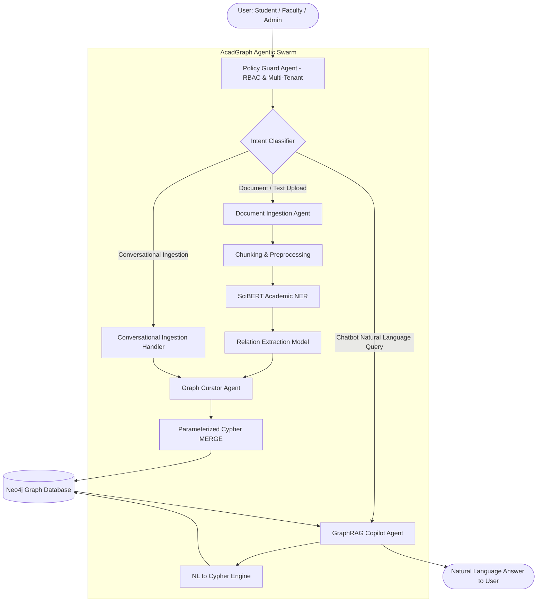

<<<<<<< HEAD
# Final_year_phase_1_2
=======
# AcadGraph: Agentic AI-Driven Multi-Tenant Academic Knowledge Graph Platform

[](https://www.python.org/)
[](https://fastapi.tiangolo.com/)
[](https://neo4j.com/)
[](https://huggingface.co/)
[]()
[]()

**AcadGraph** is an enterprise-grade, Multi-Tenant Academic Knowledge Graph SaaS platform powered by an **Agentic AI Multi-Agent Swarm**. It transforms unstructured academic documents (course syllabi, research papers, project proposals) into structured, queryable knowledge graphs in **Neo4j** while enforcing strict Role-Based Access Control (RBAC) and tenant data isolation across universities.

---

## 🌟 Key Features

1. **Multi-University (Multi-Tenancy) Architecture in Neo4j**:
   - Schema partitioned by `university_id` across all local nodes (`Student`, `Faculty`, `Course`, `Project`, `Department`).
   - Global shared nodes for `Skill` and `Topic` to enable cross-university research and trend analytics.
   - High-throughput Cypher `MERGE` query execution via Neo4j Bolt and HTTP Query API v2.

2. **Role-Based Access Control (RBAC)**:
   - 4-Tier Granular Permissions:
     - **Super Admin**: Platform-wide monitoring, university onboarding, cross-tenant insights.
     - **University Admin / Dean**: Curriculum approval, faculty/student directory management, department skill gap analytics.
     - **Faculty**: Upload syllabi, create projects, supervise students, skill gap analysis.
     - **Student**: Profile exploration, personalized project recommendations, AI copilot queries.
   - Guarded by autonomous **Policy Guard Agent** preventing cross-tenant data leaks and unauthorized mutations.

3. **Document Ingestion Studio (Text -> Knowledge Graph)**:
   - Accepts `.txt`, `.csv`, `.md`, or raw pasted text.
   - Intelligent Chunking & Sentence Segmentation.
   - **SciBERT Academic NER**: Discovers `STUDENT`, `FACULTY`, `COURSE`, `PROJECT`, `SKILL`.
   - **Trained Relation Extraction Model**: Predicts `WORKS_ON`, `TEACHES`, `SUPERVISES`, `REQUIRES_SKILL`, `HAS_SKILL`.
   - Automated idempotent insertion into Neo4j via `GraphCuratorAgent`.

4. **Agentic AI Copilot (GraphRAG Chatbot)**:
   - **GraphRAG Mode**: Answers complex natural language queries by executing university-scoped Cypher queries against Neo4j.
   - **Conversational Ingestion Mode**: Directly adds academic projects, faculty supervisions, and required skills when typed conversationally in chat.

---

## 🏛️ System Architecture



---

## 📁 Repository Structure

```
├── agents/                       # Agentic AI Multi-Agent Swarm
│   ├── agent_orchestrator.py     # Central coordinator for all agents
│   ├── document_agent.py         # Document ingestion, SciBERT NER & chunking
│   ├── graph_curator_agent.py    # Idempotent Cypher MERGE generator for Neo4j
│   ├── graph_rag_agent.py        # GraphRAG NL2Cypher chatbot & conversational ingestion
│   └── policy_guard_agent.py     # RBAC & Tenant boundary enforcement
├── api/                          # FastAPI REST API & Core Services
│   ├── auth.py                   # JWT Auth, password hashing & RBAC dependencies
│   ├── tenancy.py                # Multi-university tenant models & metrics
│   └── recommendation_api.py     # Unified FastAPI application with all routes
├── core/                         # Core Database Engine
│   └── neo4j_client.py           # Unified Neo4j Client (Bolt / HTTP v2 / Resilient Fallback)
├── model/                        # AI Models & Academic Engines
│   ├── scibert_ner_model/        # Fine-tuned SciBERT Token Classification Model
│   ├── relation_model.pkl        # Trained academic relation classification model
│   ├── relation_vectorizer.pkl   # TF-IDF relation feature vectorizer
│   ├── recommendation_engine.py  # Student-project graph matching engine
│   ├── knowledge_gap_engine.py   # Curriculum vs Industry skill gap engine
│   └── temporal_engine.py        # Longitudinal research trend engine
├── templates/                    # Web UI Dashboards
│   ├── index.html                # Multi-tenant home portal & quick launcher
│   ├── chat.html                 # Interactive Agentic Academic Copilot UI
│   ├── upload.html               # Document Knowledge Ingestion Studio
│   ├── graph.html                # Interactive Neo4j graph visualizer
│   ├── recommendation.html       # Project recommendation dashboard
│   ├── knowledge_gap.html        # Skill gap analysis report
│   └── temporal.html             # Research & enrollment temporal trends
├── dataset/                      # Academic datasets (courses, faculty, students, etc.)
├── demo_live_execution.py        # End-to-end verification script
├── test_agentic_pipeline.py      # Automated unit & integration test suite
└── .env.example                  # Environment configuration template
```

---

## 🚀 Quickstart Guide

### 1. Installation
Clone the repository and install dependencies:
```bash
git clone https://github.com/priyankapanneer/Final_year_phase_1_2.git
cd Final_year_phase_1_2
pip install -r requirements.txt  # or install fastapi uvicorn neo4j torch transformers pyjwt pydantic requests
```

### 2. Configure Environment (Optional)
Copy `.env.example` to `.env` and configure your Neo4j credentials:
```bash
cp .env.example .env
```
*(Note: If no Neo4j credentials are provided, AcadGraph automatically operates in a resilient mock fallback mode for development without crashing).*

### 3. Run Test Suite
Verify that all agents, RBAC guardrails, and ingestion pipelines pass:
```bash
python test_agentic_pipeline.py
python demo_live_execution.py
```

### 4. Start Server
Launch the FastAPI development server:
```bash
uvicorn api.recommendation_api:app --reload --port 8000
```

Open your browser at:
- **Home Dashboard:** [http://localhost:8000/](http://localhost:8000/)
- **Academic Copilot (Chatbot):** [http://localhost:8000/chat](http://localhost:8000/chat)
- **Document Ingestion Studio:** [http://localhost:8000/upload](http://localhost:8000/upload)
- **Interactive Graph Visualizer:** [http://localhost:8000/graph](http://localhost:8000/graph)
- **Interactive Swagger Docs:** [http://localhost:8000/docs](http://localhost:8000/docs)

---

## 👥 Demo Personas (Pre-seeded for RBAC testing)

| Role | Username | Password | Tenant / University Scope |
| :--- | :--- | :--- | :--- |
| **Super Admin** | `superadmin@acadgraph.io` | `admin123` | Global (`ALL`) |
| **University Admin** | `admin@annauniv.edu` | `anna123` | Anna University (`UNI_ANNA`) |
| **Faculty (Prof)** | `faculty.kumar@annauniv.edu` | `kumar123` | Anna University (`UNI_ANNA`) |
| **Student** | `student.ravi@annauniv.edu` | `ravi123` | Anna University (`UNI_ANNA`) |
| **University Admin** | `admin@iitm.ac.in` | `iitm123` | IIT Madras (`UNI_IITM`) |
| **Student** | `student.priya@iitm.ac.in` | `priya123` | IIT Madras (`UNI_IITM`) |
>>>>>>> e013ea5 (feat: agentic multi-tenant academic knowledge graph with Neo4j, RBAC, document ingestion and chatbot)
